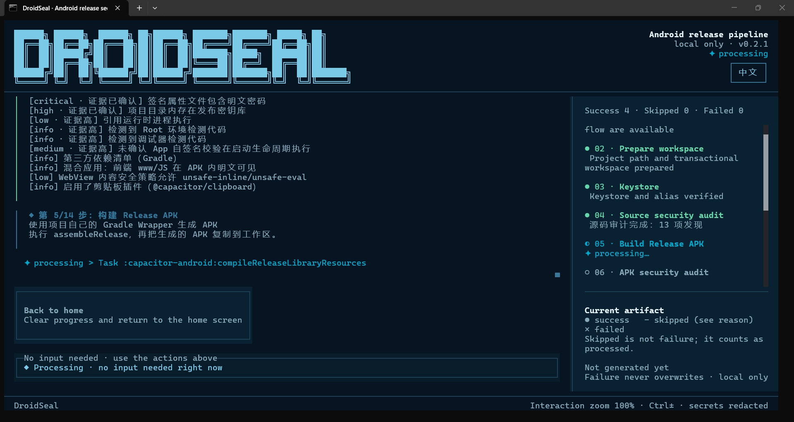

# DroidSeal · Android Release Seal

[中文](README.zh-CN.md) | [English](README.md)

[](https://github.com/noontiger/droidseal/blob/main/LICENSE)
[](https://www.npmjs.com/package/droidseal)
[](https://pypi.org/project/droidseal)

**DroidSeal** handles most of what you can do before commercial hardening — environment diagnosis, source & APK audit, R8 obfuscation, zipalign alignment, apksigner signing and final verification. One command, end to end, before commercial hardening.

## What it does

- **Audit**: static audit of projects and APKs — permissions, targetSdk, signing schemes, hardcoded secrets, DEX/TLS heuristics, native `.so` hardening, third-party dependencies and a CycloneDX SBOM;
- **Release**: runs `zipalign → apksigner sign → verify` in the official order, with automatic rollback on failure and an independent artifact per step;
- **Artifacts**: APK + SHA-256 + JSON/Markdown reports + a release gate + SBOM.



## Install

| Channel | How |
|---|---|
| npm | `npm install --global droidseal` |
| PyPI | `pip install droidseal` |
| GitHub Releases | Download the Windows zip / Linux tar.gz directly |

> **Windows note**: if SmartScreen blocks the exe on double-click, right-click → Properties → Unblock. The TUI must run in a terminal: run `droidseal` in PowerShell, or double-click the bundled `droidseal-gui.cmd` launcher.

## Usage

```powershell
droidseal              # interactive TUI wizard (one-click / step-by-step)
droidseal doctor       # non-interactive environment diagnosis
droidseal --version
```

### APK hardening mode (opt-in)

`droidseal <input.apk> --output <dir> --cert-sha256 <sha256> --keystore <jks> --ks-alias <alias> --ks-pass <pass> --key-pass <pass>`

Runtime-hardens a release APK: DEX payload encryption (AES-256-GCM, per-entry HKDF-derived keys), a randomized bootstrap shell (dual-DEX: a plaintext stub loads an encrypted loader from assets), shell entry-class / container-magic / meta-key randomization per build, method code-item extraction, and optional NDK split-key part2 relocation into a native library. Every build emits an honest findings report — anything not implemented is reported as a finding, never claimed as protection.

**AI-era hardening layers** (designed so tampering produces wrong keys, not warnings — nothing for a tool to "read and bypass"):

- **Integrity anchor in key derivation**: the final binary `AndroidManifest.xml` SHA-256 is folded into every per-entry HKDF info. Re-packaging always edits the manifest → wrong keys → GCM silently fails (P0-A).
- **Environment gate in key derivation**: runtime anti-analysis votes (Java detection + a native fork-based parent-TracerPid check / port probe / maps scan + the debuggable flag) are folded into the same HKDF info. Attach Frida and the derived keys are simply wrong — no signal to locate (P0-B).
- **Key sharding**: the master key is recombined per-entry and wiped immediately; no complete key ever sits in memory, and decrypted DEX buffers are zeroed right after class loading (P0-C).
- **Redundant heterogeneous detection**: three independent sources (Java / native C / system flags) with different read paths — bypassing one does not flip the vote (P1). Note: the native port probe tests localhost 27042/27043 (Frida defaults); another process legitimately listening on those ports on the same device (e.g. while instrumenting a *different* app) can produce a false positive.

| Flag | Effect |
|---|---|
| `--cert-sha256 <hex>` | signing-cert fingerprint; keys derive from it — **re-signing with a different key breaks decryption by design** |
| `--no-random-names` | keep fixed shell identifiers (debugging only) |
| `--no-triple-entry` | skip extra shell entry hooks |
| `--keystore-bind` | seal key part1 with Android Keystore after first run — reinstall/device change invalidates it |
| `--challenge-url <url>` | server-side challenge (opt-in): key part3 is stripped from the APK and served from your HTTPS endpoint after verifying the caller's manifest hash; builds emit `server-challenge.json` for deployment — **losing that file makes the build permanently undecryptable**. Reference server: `scripts/challenge-server.ts`. **Honest caveat**: the manifest hash is publicly computable from the APK, so this check is *not* authentication — it only stops a *different* APK from grabbing this build's part3. Anyone holding both the APK and `server-challenge.json` can reconstruct the key offline; treat that file as key material (store offline, never commit it). |

**Expectation management**: hardening raises reverse-engineering cost; it does not make reversing impossible. On rooted devices with Frida, in-memory DEX dumps cannot be fully prevented by any offline packer — the layers above shrink the window and poison tampered environments, but a sufficiently skilled attacker with sustained physical access still wins eventually. `minSdk < 26` falls back to a file-backed `DexClassLoader` (still works, slightly weaker isolation). The server challenge is rate-limitable but its endpoint availability becomes a runtime dependency (offline devices cannot decrypt). Real-device install is the only authoritative acceptance test.

## Platform & status

- **Platform**: Windows x64 / Linux x64;
- **Status**: 1.0.1 stable — the CLI, output layout and report formats are now stable;
- **Software**: an ANSI/Unicode-capable monospace terminal is required for the TUI; Bun 1.3+ to run from source; JDK/Gradle/Android Build Tools are auto-discovered or downloaded per flow (Node only for Capacitor web builds);
- **Hardware (practical advice, not a hard floor)**: ~500 MB disk (100 MB executable + toolchain + artifacts), ≥2 GB RAM (more for large APKs — parsing is memory-sensitive with a fail-safe cap), x64 dual-core CPU.

## Positioning

Android security tooling splits into two tracks: **audit** (MobSF, AndroBugs, APKiD — analyze, never rewrite) and **hardening** (commercial: DexGuard / DexProtector / 360 Jiagu; open source: Jiagu, nmmp, dpt-shell, XopProtector — rewrite the APK). DroidSeal deliberately spans both, which no other open-source project does in one offline pipeline.

| Track | Closest peers | What DroidSeal adds |
|---|---|---|
| Audit | MobSF (deepest analysis, ~19k★), AndroBugs, APKiD | Audit findings drive **fixes in the same toolchain**: audit → remediation report → R8 → hardening → re-sign → re-verify, with a CycloneDX SBOM and release-evidence chain (releaseDecision / remediation). MobSF stops at the report. No dynamic analysis / taint analysis / iOS — use MobSF for those. |
| Hardening (open source) | dpt-shell (method-level), nmmp (VMP), XopProtector | **Keyed defenses**: integrity anchors and anti-analysis votes fold into per-entry key derivation (P0-A/B/C, P1) — patching detection code restores the *correct* key, but attaching Frida without patching derives *wrong* keys. Mainstream shells detect-and-warn; bypassing the check costs nothing. Also: key sharding (part2 → SO, optional part3 → server), Keystore device binding, honest findings. |
| Hardening (commercial) | DexGuard, DexProtector, 360 加固保 | Fully **offline** (code never leaves your machine — the main reason teams pick open-source hardening over cloud services), auditable behavior, no per-app pricing. Trade-off: no VMP/white-box crypto, less battle-tested, no SLA. |

**Where DroidSeal does NOT compete (honest boundaries)**:

- Need VMP-grade protection that survives a memory dump of the master key? Use nmmp or DexGuard — DroidSeal explicitly does not invest in white-box AES or VM-based protection; on rooted devices with sustained physical access, a sufficiently skilled attacker eventually wins.
- Doing malware triage or dynamic behavior analysis? Use MobSF + APKiD — DroidSeal only audits and hardens, it never sandboxes.
- Need contractual support/SLA for a high-stakes product? The project is early (real-device acceptance, independent security review, and community size are all still ahead of it) — commercial vendors are the safer bet there.

**One-line summary**: unmatched as an offline audit→harden→sign→verify pipeline; mid-pack on raw hardening strength; keyed defenses are the differentiator; maturity is the biggest gap.

## Measured capabilities (benchmarked, not claimed)

Numbers below come from reproducible harnesses in [`benchmark/`](benchmark/README.md); each is stated with its measurement criteria — the same discipline the tool applies to its own findings.

**Audit (static analysis)**

| Capability | Measured | Criteria |
|---|---|---|
| Malicious-flow detection (TaintBench, 39 apps / 249 GT flows) | endpoint TP 171 / 249 (68.7%), flow TP 136 | endpoint = target API present in the GT class; flow = both ends hit |
| False positives (434 benign apps, AndroZoo VT=0 proxy) | dataflow engine FP = **0** (95% CI upper 0.69%) | only the dataflow layer counts; auxiliary config hints reported separately |
| Detector base (source/config/hardening patterns) | 379 detectors, precision 76.9% / recall 90.9% on the 38-case built-in bench | pattern-level, MSTG-mapped |
| JNI dynamic-register recovery | registry-string co-occurrence + DEX cross-validation | new finding class `JNI_DYNAMIC_REGISTER`; native attack surface invisible to static symbol scans |
| Native linear dataflow | JNI exported-function source→sink co-occurrence | **linear heuristic, not pointer analysis**; `confidence: low` by design |

**Hardening (release APK, opt-in)**

| Layer | Status |
|---|---|
| DEX payload encryption (AES-256-GCM, HKDF, keyed anchors P0-A/B/C) | shipped; emulator-accepted (SEC-010/011/012 fixed via real-device loop) |
| Method extraction (code-item hollowing) + lazy restoration | shipped; fail-open fallback to full restore |
| String encryption with call-site rewrite (MUTF-8 safe ciphertext + checksum recompute) | shipped; apktool fail-closed on write-back |
| VMP-lite | milestone A shipped (leaf-method interpreter, TS/C cross-checked 12 tests); **milestone B (RegisterNatives bridge + stub `ACC_NATIVE` marking) is build-time code only — `vmProtected` stays `false` until a real-device matrix (API 24–35) passes** |
| Keyed defenses (integrity anchor / environment gate / key sharding / server challenge) | shipped, with honest caveats in the hardening section below |

**Honest boundaries of the numbers**: TaintBench line numbers and jadx line numbers are different sources (230 endpoints, only 6 exact) — connected-level matching therefore offers a strict tier (line ±2, historically 0) and a lenient tier (class-stem alignment, 66/249); the lenient tier must never be quoted alone. Obfuscated GT method names (`i`, 31 occurrences) are recovered only when the wrapping method body contains exactly one known source/sink API; ambiguous cases are dropped, not guessed.


Maturity here means *claimed capabilities are tested capabilities* — three layers, from cheapest to most expensive:

| Layer | Tool | When it runs | What it proves |
|---|---|---|---|
| Unit + regression | `bun test` | every change (CI core job) | crypto layout, URL patching, container format invariants |
| Security regression | `bun test tests/security-regression.test.ts` | mandatory per security fix | each accepted security fix ships a `SEC-XX` test reproducing its *trigger condition* (red on pre-fix code, green after; policy in [SECURITY.md](SECURITY.md#adversarial-regression-policy), full fix history in the [Security Ledger](docs/security-ledger.md)) — covers C1 (no PTRACE_TRACEME in generated native source), C3 (pre-XOR seal ordering), C4 (byte-length-preserving debuggable flip), C5 (whitelist smoke permanence), R2/R3 |
| Artifact baseline | `bun scripts/verify-harden-artifact.ts <apk>` | after every harden build | encrypted loader present & stored (H1/H2), container stored with valid magic (H3/H4), no key material in plaintext DEX (H5), shell manifest present (H6); `--expect-plain` asserts a *non*-hardened APK |
| Device acceptance | `bash scripts/device-test.sh <apk> <package> [--ks-relaunch]` | on real devices/emulators | install → 5s-alive decrypt-and-launch loop, no integrity/BadTag markers, Keystore-binding relaunch; full matrix and manual cases (re-sign must fail, offline challenge fail-closed, Frida) in `docs/device-testing.md`; threat surface & residual risks in the [threat model](docs/threat-model.md), build-level proof-of-attack in `scripts/attack-sample-resign.ts` (re-sign must fail, by construction) |

CI (`.github/workflows/ci.yml`) runs `tsc --noEmit` + full tests + an npm-pack whitelist smoke on every push/PR, plus a separate NDK job that compiles the generated native shell sources (including `guard_vote.c`) with a real NDK — the native path is no longer paper-only. Releases: `bun scripts/release.ts <version> [--sync]` runs local verification and creates a local git tag only; uploading (git push / npm publish) is always a deliberate human step.

**Honest boundary**: build-time green ≠ runtime correct. The device layer above is the only trustworthy acceptance, and it needs real hardware.

**Emulator acceptance record (2026-09)**: the first full emulator run (API 26 x86_64) *crashed on launch* despite 264/264 tests and the H1–H6 artifact baseline all being green — and fixing the first defect exposed the second, then the third. Three build-level defects that no static check could catch were found and fixed ([SEC-010](docs/security-ledger.md#sec-010--patched-payload-dex-fails-art-checksum-verification-critical) checksum/signature ordering, [SEC-011](docs/security-ledger.md#sec-011--method-extraction-stub-leaves-non-zero-padding-at-section-boundary-critical) non-zero section padding from extraction stubs, [SEC-012](docs/security-ledger.md#sec-012--identifier-randomization-breaks-dex-string_ids-ordering-critical) out-of-order string_ids from identifier randomization). Re-test after all three fixes: install PASS, first launch PASS, second launch PASS, zero logcat failure markers, clean uninstall (D1/D2/D3/D5). This is the concrete proof behind the honest boundary above: the device layer is the only one that catches this defect class.

## Security boundary

A defensive tool: by default it does not unpack, pack, or inject hooks / anti-debug code; it runs fully locally and never uploads APKs, paths or signing information.

**Exception — APK hardening mode (explicit opt-in)**: when you pass an APK with the hardening flags above, DroidSeal *does* pack (DEX encryption + bootstrap shell injection into **your own release APK**) and embeds anti-analysis detection. This mode only ever modifies the APK you explicitly supply as input; the default audit/release flows keep the no-packing boundary.

## Architecture, innovation & self-developed parts

### Innovation highlights

1. **Fully self-developed APK format handling**: parsing and rewriting of the ZIP central directory, ARSC resource table, AXML, DEX and ELF are all self-implemented at the byte level — no heavy parser dependencies (supply-chain convergence, clear failure semantics);
2. **Deterministic post-processing**: unchanged ZIP entries reuse the original compressed bytes, reducing unexpected churn in repacking / recompression / signing digests;
3. **Failure rollback**: each step keeps an independent APK artifact; "skip and roll back" preserves the last valid artifact before the step;
4. **Self-developed anti-debug stub** (C + Kotlin + CMake, optional source integration);
5. **Auditable results**: signature verification + SHA-256 + JSON/Markdown reports + CycloneDX SBOM + confidence-aware release gate;
6. **Pure local-first**: never uploads APKs, paths or signing information; by default no unpacking, packing or injection;
7. **Single binary, three channels**: Bun-compiled single-file executable with zero runtime npm dependencies; same-source release on npm / PyPI / GitHub Releases;
8. **Bilingual TUI + three entry points** (step-by-step / one-click / diagnosis).

### Self-developed vs third-party calls

- **Self-developed** (business core): `src/core` (139 modules — ZIP/DEX/ELF/ARSC/AXML parsing and audit, pipeline orchestration, signing strategy, release gate, taint dataflow, VMP-lite compiler, JNI dynamic-register recovery), `src/ui` (TUI + i18n), the anti-debug stub, `scripts` (build/release/gate/bench scripts), and the dual launchers;
- **Third-party** (rendering/build layer): OpenTUI (terminal rendering), Solid.js (reactive UI), Terser (build minification, optional web JS only), TypeScript/Bun (toolchain), and external Android tools (keytool/Gradle/zipalign/apksigner/aapt — orchestrated through self-developed discovery and verification).

### Pipeline visualization (self/third-party per step)

The route bends top-to-bottom: the left column ①-⑦ runs downward, then folds at the bottom "flow" and the right column ⑧-⑭ runs upward (snake shape). Each step box is annotated "Self: …" or "Third-party: …".

```text
┌────────────────────────────────┐      ┌────────────────────────────────┐
│ ① Environment diagnosis        │      │ ⑭ Generate reports             │
│ Self: tool discovery/verify    │      │ Self: report/gate/SBOM/fix pack│
└────────────────────────────────┘      └────────────────────────────────┘
                │                      ▲
                ▼                      │
┌────────────────────────────────┐      ┌────────────────────────────────┐
│ ② Prepare workspace            │      │ ⑬ Final verification           │
│ Self: input validation/copy    │      │ Third-party: apksigner verify  │
└────────────────────────────────┘      │ Self: SHA-256 calculation      │
                                        └────────────────────────────────┘
                │                      ▲
                ▼                      │
┌────────────────────────────────┐      ┌────────────────────────────────┐
│ ③ Signing keystore             │      │ ⑫ Sign APK                    │
│ Third-party: keytool            │      │ Third-party: apksigner        │
│ Self: credential safety         │      │ Self: key handling/redaction  │
└────────────────────────────────┘      └────────────────────────────────┘
                │                      ▲
                ▼                      │
┌────────────────────────────────┐      ┌────────────────────────────────┐
│ ④ Source security audit        │      │ ⑪ ZIP alignment               │
│ Self: project-audit/r8-rules   │      │ Third-party: zipalign          │
└────────────────────────────────┘      └────────────────────────────────┘
                │                      ▲
                ▼                      │
┌────────────────────────────────┐      ┌────────────────────────────────┐
│ ⑤ Build release APK            │      │ ⑩ Resource obfuscation (opt.)  │
│ Third-party: Gradle Wrapper    │      │ Self: arsc-obfuscate           │
└────────────────────────────────┘      └────────────────────────────────┘
                │                      ▲
                ▼                      │
┌────────────────────────────────┐      ┌────────────────────────────────┐
│ ⑥ APK security audit           │      │ ⑨ Web JS handling (opt.)       │
│ Self: ZIP/DEX/ELF/ARSC/AXML    │      │ Third-party: Terser minify     │
│ Third-party: aapt supplement   │      │ Self: allowlist/atomic write   │
└────────────────────────────────┘      └────────────────────────────────┘
                │                      ▲
                ▼                      │
┌────────────────────────────────┐      ┌────────────────────────────────┐
│ ⑦ Local security shield        │      │ ⑧ Release normalization       │
│ Self: evidence/confidence      │      │ Self: manifest rewrite/debug   │
└────────────────────────────────┘      └────────────────────────────────┘
               └────────► flow ──►────┘
```

All format parsing / rewriting / auditing / reporting is self-developed (offline, low supply-chain footprint); rendering uses OpenTUI/Solid (third-party); external tools are called only in officially mandated steps, always orchestrated through self-developed discovery, SHA-256 verification and graceful degradation.

## License & brand

- Open-source license: [Apache License 2.0](https://github.com/noontiger/droidseal/blob/main/LICENSE)
- Name and logo usage: [TRADEMARKS.md](https://github.com/noontiger/droidseal/blob/main/TRADEMARKS.md) (attribute the source in reviews, tutorials and sharing)
