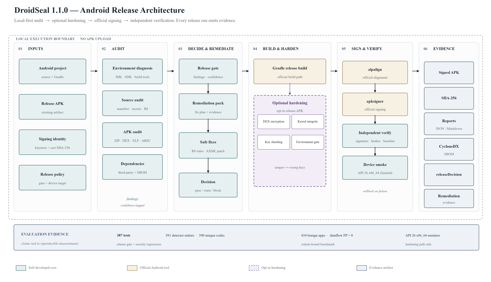
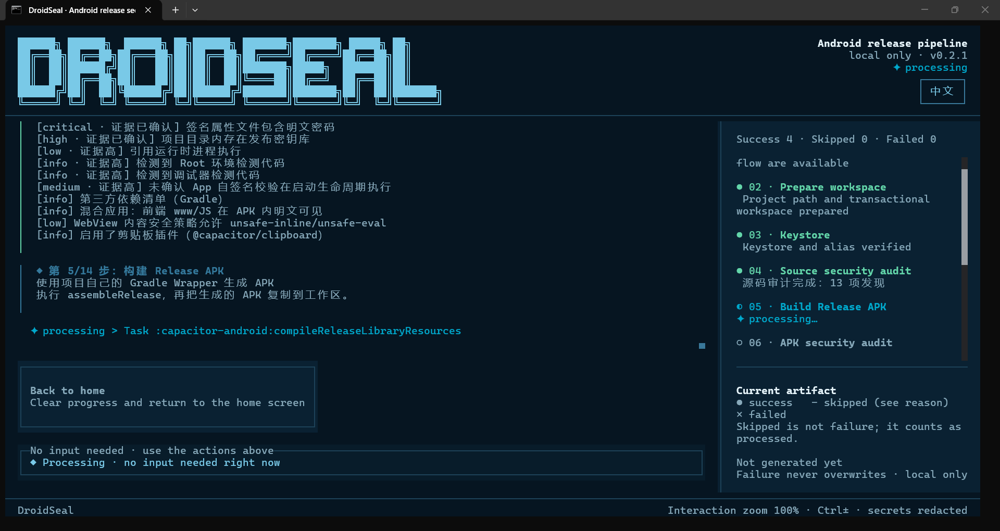

# DroidSeal · 安卓发布封签

[English](README.md) | [中文](README.zh-CN.md)

[](https://github.com/newnju/droidseal/blob/main/LICENSE)
[](https://www.npmjs.com/package/droidseal)
[](https://pypi.org/project/droidseal)

**发布一个经得起审查的 Android 版本。**

DroidSeal 是本地优先的发布流水线：审计应用、按需加固 APK、用官方 Android 工具签名，并独立验证结果。每次发布运行都会留下可核查的证据——SHA-256、JSON/Markdown 报告、CycloneDX SBOM 与发布决策。

> **版本范围**：本文档描述 DroidSeal **1.1.0**（tag `v1.1.0`）。功能与证据见 [1.1.0 发布说明](https://github.com/newnju/droidseal/blob/v1.1.0/docs/releases/v1.1.0.zh-CN.md)。

[发布说明](https://github.com/newnju/droidseal/blob/v1.1.0/docs/releases/v1.1.0.zh-CN.md) · [安全策略](https://github.com/newnju/droidseal/blob/v1.1.0/SECURITY.zh-CN.md) · [威胁模型](https://github.com/newnju/droidseal/blob/v1.1.0/docs/threat-model.zh-CN.md) · [基准测试](https://github.com/newnju/droidseal/blob/v1.1.0/benchmark/README.md)

**快速开始：** `npm install --global droidseal` → `droidseal` → 选择审计、发布或可选加固。

**证据速览：** 387 项测试 · 391 条检测器条目（390 个唯一 code）· 434 个良性应用，数据流 FP = 0 · API 26 x86_64 模拟器验收（加固路径）。

## 架构

<p align="center">
  <a href="https://raw.githubusercontent.com/newnju/droidseal/v1.1.0/docs/assets/droidseal-architecture.svg">
    
  </a>
</p>

**图 1.** DroidSeal 1.1.0 发布架构。青色实线框为自研组件，琥珀色框为官方 Android 工具，紫色虚线路径为可选的 APK 加固。每次发布运行都会生成证据包（签名 APK、SHA-256、报告、SBOM 与发布决策）。设备层仅覆盖文中所列模拟器矩阵。

## 为什么是 DroidSeal

Gradle 构建成功，只证明代码能编译；它不证明签名正确、没有发布阻断项，也不证明产物与审计时一致。

DroidSeal 补上这一段：

- **在用户之前发现发布阻断项**——权限、签名方案、硬编码密钥、DEX/TLS 启发式、native `.so` 加固、第三方依赖；
- **不上传 APK 也能加固**——可选的 DEX 加密与密钥化完整性/环境检查；篡改导致错误密钥，而不是输出可绕过的警告；
- **按 Android 官方方式签名与验证**——`zipalign → apksigner → verify`，每步独立产物，失败自动回滚；
- **证明最终发布的是什么**——SHA-256、报告、SBOM、发布门禁与修复证据集中在同一输出目录。

适合需要可审计发布流程、但不想引入黑盒云服务的中小 Android 团队、安全评审者与 CI 流水线。

## 能做什么

- **审计**：项目与 APK 静态审计——权限、targetSdk、签名方案、硬编码密钥、DEX/TLS 启发式、Native so 加固、第三方依赖与 CycloneDX SBOM；
- **发布**：按官方顺序执行 `zipalign → apksigner 签名 → 验证`，失败自动回退，每步独立制品；
- **产物**：APK + SHA-256 + JSON/Markdown 报告 + 发布门禁 + SBOM。



## 安装

| 渠道 | 方式 |
|---|---|
| npm | `npm install --global droidseal` |
| PyPI | `pip install droidseal` |
| GitHub Releases | 直接下载 Windows zip / Linux tar.gz |

> npm 包内为带完整性校验的单文件 bundle(`dist/droidseal.mjs`):`droidseal` 启动器每次运行先校验 bundle 的 SHA-256(与构建元数据比对)再加载——需要 Node.js ≥ 18。安装后执行 `droidseal --version` 确认可用。

> **Windows 提示**：双击 exe 被 SmartScreen 拦截时，右键 → 属性 → 解除锁定。TUI 需在终端中运行：PowerShell 执行 `droidseal`，或双击随包附带的 `droidseal-gui.cmd` 启动器。

## 使用

```powershell
droidseal              # 交互式 TUI 向导（一键 / 分步）
droidseal doctor       # 非交互环境诊断
droidseal --version
```

### APK 加固模式（可选）

`droidseal <input.apk> --output <dir> --cert-sha256 <sha256> --keystore <jks> --ks-alias <alias> --ks-pass <keystore-password> --key-pass <key-password>`

> **凭据处理**：上面的命令只使用占位符。优先使用 TUI 的交互式密码输入；如果必须使用非交互参数，请避免把生产密码写入 shell 历史和日志，并在使用后立即删除临时凭据文件。

对 release APK 做运行时加固：DEX payload 加密（AES-256-GCM，逐条目 HKDF 派生密钥）、随机化引导壳（双 DEX：明文 stub 运行时解密加载 assets 中的加密 loader）、壳入口类 / 容器 magic / meta 键逐构建随机化、方法 CodeItem 抽取、可选 NDK 将 Split-Key part2 异位进原生库。每次构建都输出如实的 findings 报告——未实现的能力一律如实标注，绝不虚报为防护。

**密钥化加固层**（篡改导致错误密钥，而不是输出可被绕过的警告）：

- **完整性锚点参与密钥派生**：最终二进制 `AndroidManifest.xml` 的 SHA-256 折入每条目 HKDF info。重打包必改 manifest → 密钥错 → GCM 静默失败（P0-A）。
- **环境门控参与密钥派生**：运行时反分析投票（Java 检测 + native fork 跨进程读父进程 TracerPid / 端口探测 / maps 扫描 + debuggable 标志）折入同一 HKDF info。挂上 Frida 后派生的密钥就是错的——没有可定位的信号（P0-B）。
- **密钥分片化**：master 密钥逐条目临时合成、用后立即清零；任意时刻内存无完整密钥，解密后的 DEX 缓冲在类加载完成后即刻清零（P0-C）。
- **冗余异构检测**：三个独立源（Java / native C / 系统标志）读取路径各异——绕过单一源不影响投票结果（P1）。注意：native 端口探测检查本机 27042/27043（Frida 默认端口）；同设备上其他进程恰好在监听这些端口（例如正在调试**另一个**应用）可能造成误判。

| 开关 | 作用 |
|---|---|
| `--cert-sha256 <hex>` | 签名证书指纹；密钥由其派生——**换证书重签会导致解密失败（设计使然）** |
| `--no-random-names` | 保留固定壳标识符（仅调试用） |
| `--no-triple-entry` | 跳过额外壳入口 hook |
**预期管理**：加固提高逆向成本，而非使逆向不可能。root + Frida 环境下内存 DEX dump 无法被任何离线加壳方案完全防住——上述各层只是收窄窗口、降低被篡改环境的可用性，技术足够且能长期物理接触的攻击者最终仍能得手。`minSdk < 26` 自动降级为落盘 `DexClassLoader`（仍可运行，隔离性略弱）。真机安装是唯一可信验收。

## 平台与状态

- **平台**：Windows x64 / Linux x64；
- **状态**：1.1.0（tag `v1.1.0`）——CLI、输出目录与报告格式稳定；APK 加固为 opt-in，设备验证矩阵有限，请在自有设备上验收；
- **软件要求**：支持 ANSI/Unicode 的交互式等宽字体终端（TUI 必需）；源码运行需 Bun 1.3.14；JDK/Gradle/Android Build Tools 按流程自动发现或下载（Node 仅 Capacitor Web 构建时）；
- **硬件（实用建议，非硬性下限）**：约 500 MB 磁盘（100 MB 可执行文件 + 工具链 + 产物）、≥2 GB 内存（大 APK 更高——解析内存敏感，带失败安全上限）、x64 双核 CPU。

## 定位与对比

Android 安全工具通常分为两条赛道：**审计**（MobSF、AndroBugs、APKiD——只分析、不改写）与**加固**（商业：DexGuard / DexProtector / 360 加固保；开源：Jiagu、nmmp、dpt-shell、XopProtector——改写 APK）。DroidSeal 在同一条离线流水线中整合审计、可选加固、签名与验证；不声称在专用审计或 VMP 产品上逐项对标。

| 赛道 | 最接近的对标 | DroidSeal 的增量 |
|---|---|---|
| 审计 | MobSF（广泛的静态/动态分析）、AndroBugs、APKiD | 审计结论直接驱动**同一工具链内的修复**：审计 → remediation 报告 → R8 → 加固 → 重签 → 复验，附 CycloneDX SBOM 与发布证据链（releaseDecision / remediation）。MobSF 覆盖动态分析与报告；DroidSeal 聚焦发布流水线。 |
| 加固（开源） | dpt-shell（方法级）、nmmp（VMP）、XopProtector | **密钥化防御**：完整性锚点与反分析投票折入逐条目密钥派生（P0-A/B/C、P1）——patch 掉检测代码会让环境"恢复干净"从而密钥正确，但不 patch 直接挂 Frida 派生的就是**错钥**。设计目标是让 patch 检测不等于简单关闭警告；未通过检查的输入派生出错误密钥。这是设计属性，不代表所有商业壳的行为。另有：密钥分片（part2 入 SO）、诚实 findings。 |
| 加固（商业） | DexGuard、DexProtector、360 加固保 | 完全**离线**（代码不出本机）、行为可审计。代价：无 VMP/白盒密码、实战验证较少、无 SLA。 |

**DroidSeal 不参与竞争的场景（如实边界）**：

- 需要"master 密钥被内存 dump 后仍不可读"的 VMP 级防护？用 nmmp 或 DexGuard——DroidSeal 1.1.0 不交付 VMP 层，也不投入白盒 AES 与全指令集 VM 保护；root + 持久物理接触下，技术足够强的攻击者最终仍能得手。
- 做恶意 App 鉴别或动态行为分析？用 MobSF + APKiD——DroidSeal 只审计与加固，不做沙箱。
- 高风险产品需要合同化支持/SLA？项目尚早期（真机验收、独立安全审计、社区规模都还在路上）——这类需求选商业厂商更稳妥。

**一句话总结**：提供离线"审计→可选加固→签名→验证"流水线及可审计证据链；加固强度不声称对标商业 VMP 产品；成熟度是主要短板。

## 实测能力(基准数字,不是宣称)

以下数字全部来自 [`benchmark/`](benchmark/README.md) 下可复现的基准 harness;每项都随附测量口径——与工具对自身 finding 的要求同一纪律。

**审计(静态分析)**

| 能力 | 实测 | 口径 |
|---|---|---|
| 恶意流检测(TaintBench,39 app / 249 条 GT 流) | 端点级 TP 171/249(68.7%),流级 TP 136 | 端点级 = GT 类中出现 target API;流级 = 两端同时命中 |
| 误报率(434 个良性 app,AndroZoo VT=0 代理) | 数据流引擎层 FP = **0**(95% CI 上界 0.69%) | 只认数据流层;辅助配置类提示单列 |
| 检测器基座(源码/配置/加固模式) | 391 条检测器条目（390 个唯一 code）,内置 38 用例基准精确率 76.9% / 召回 90.9% | 模式级,MSTG 映射 |
| JNI 动态注册恢复 | 注册表字符串邻近共现 + DEX 交叉验证 | 新 finding 类 `JNI_DYNAMIC_REGISTER`;静态符号扫描不可见的 native 攻击面 |
| native 线性数据流 | JNI 导出函数体 source→sink 共现 | **线性启发式,非指针分析**;设计上 `confidence: low` |

**加固(发布 APK,可选)**

| 层 | 状态 |
|---|---|
| DEX payload 加密(AES-256-GCM + HKDF,密钥化锚点 P0-A/B/C) | 已交付;API 26 x86_64 模拟器验收通过,并有构建级回归(SEC-010/011/012) |
| 方法抽取(code-item hollowing)+ 惰性还原 | 已交付;fail-open 回落全量还原 |
| 字符串加密 + 调用点改写(MUTF-8 安全密文 + 校验和重算) | 已交付;写回 apktool fail-closed |
| 密钥化防御(完整性锚点/环境门控/密钥分片) | 已交付,如实边界见下文加固章节 |

**数字的如实边界**:TaintBench 行号与 jadx 行号不同源(230 端点仅 6 个精确)——连通级对判因此分严格档(行号 ±2,历史上为 0)与宽松档(类词干对齐,66/249)双档呈现;宽松档不可单独引用。混淆 GT 方法名(`i`,31 处)仅当包装方法体恰含一个已知 source/sink API 时才恢复;歧义情形如实放弃,不猜。

## 测试与验收

成熟度在这里的定义是"**声明过的能力 = 实测过的能力**"——三层验证,由廉价到昂贵:

| 层 | 工具 | 运行时机 | 证明什么 |
|---|---|---|---|
| 单元 + 回归 | `bun test` | 每次改动(CI core job) | 密码学布局、URL 补丁、容器格式不变量 |
| 安全对抗回归 | `bun test tests/security-regression.test.ts` | 每个安全修复必附 | 每个被接受的安全修复必须携带 `SEC-XX` 用例复现其*触发条件*(修复前红、修复后绿;政策见 [SECURITY.zh-CN.md](SECURITY.zh-CN.md),完整修复历史见[公开安全台账](docs/security-ledger.zh-CN.md))——覆盖 C1(生成 native 源无 PTRACE_TRACEME)、C3(pre-XOR 封存顺序)、C4(等长 debuggable 翻转)、C5(白名单冒烟常驻)、R2/R3 |
| 产物基线 | `bun scripts/verify-harden-artifact.ts <apk>` | 每次加固构建之后 | 加密 loader 存在且 stored(H1/H2)、容器 stored 且 magic 合法(H3/H4)、明文 DEX 无密钥材料(H5)、壳 manifest 存在(H6);`--expect-plain` 断言*未*加固 APK |
| 真机验收 | `bash scripts/device-test.sh <apk> <包名>` | 真机/模拟器上 | 安装 → 5 秒存活解密启动闭环、无完整性/BadTag 标记;完整矩阵与手动用例(重签必败、Frida)见 `docs/device-testing.md`;威胁面与残余风险见[威胁模型](docs/threat-model.zh-CN.md),构建级攻击实证见 `scripts/attack-sample-resign.ts`(重签必败,构建期可证) |

CI(`.github/workflows/ci.yml`)在每次 push/PR 上跑 `tsc --noEmit` + 全量测试 + npm pack 白名单冒烟,另有独立 NDK job 用真实 NDK 编译生成的 native 壳源码(含 `guard_vote.c`)——native 路径不再停留在纸面。发布:`bun scripts/release.ts <version> [--sync]` 只做本地验证与本地 git tag;上传(git push / npm publish)永远是人手动执行的显式步骤。

**如实边界**:构建期全绿 ≠ 运行时正确。上面第三层(真机)是唯一可信验收,且需要真实设备。

**模拟器实测记录(2026-09)**:首轮完整模拟器验收(API 26 x86_64)在 当时 264/264 测试与 H1–H6 产物基线全绿的情况下**首启即崩**——修掉第一个缺陷后暴露第二个,再暴露第三个。共挖出并修复三个静态检查完全测不到的构建级缺陷([SEC-010](docs/security-ledger.zh-CN.md#sec-010--补丁后-payload-dex-未通过-art-校验和验证严重) 校验和/签名顺序颠倒、[SEC-011](docs/security-ledger.zh-CN.md#sec-011--方法抽取-stub-在节区边界留下非零填充严重) 抽取 stub 残留非零节区填充、[SEC-012](docs/security-ledger.zh-CN.md#sec-012--标识符随机化破坏-dex-string_ids-字典序严重) 随机改名破坏 string_ids 字典序)。三修齐备后复测:安装 PASS、首启 PASS、二次启动 PASS、logcat 失败标记 0、卸载干净(D1/D2/D3/D5)。这就是上面那条如实边界的实证:这一类缺陷只有设备层能抓住。

## 安全边界

防御性工具：默认不脱壳、不加壳、不注入 Hook / 反调试代码；完全本地运行，不上传 APK、路径或签名信息。

**例外——APK 加固模式（显式 opt-in）**：当你携带上方加固开关传入 APK 时，DroidSeal *会*加壳（DEX 加密 + 引导壳注入，仅针对**你自己的** release APK）并内嵌反分析检测。该模式只修改你显式提供的输入 APK；默认的审计/发布流程仍保持不加壳边界。

## 架构、创新与自研部分

### 创新亮点

1. **APK 格式处理全自研**:ZIP 中央目录、ARSC 资源表、AXML、DEX、ELF 的解析与改写全部自研(字节级),不依赖庞大解析器传递依赖(供应链收敛、失败语义明确);
2. **确定性后处理**:未修改的 ZIP 条目复用原始压缩字节,减少重排/重压缩/签名摘要的意外变化;
3. **失败可回退**:每步独立 APK 制品,"跳过并回退"保留步骤前有效产物;
4. **自研反调试桩**(C + Kotlin + CMake,可选源码集成);
5. **结果可审计**:签名验证 + SHA-256 + JSON/Markdown 报告 + CycloneDX SBOM + 置信度感知发布门禁;
6. **纯本地优先**:不上传 APK、路径或签名信息;默认不脱壳、不加壳、不注入;
7. **单二进制三渠道发布**:Bun 编译单文件 exe,运行时零 npm 依赖,npm/PyPI/GitHub Release 同源发布;
8. **双语 TUI + 三入口**(分步/一键/诊断)。

### 自研部分 vs 第三方调用

- **自研**(业务核心):`src/core`(139 个模块——ZIP/DEX/ELF/ARSC/AXML 解析与审计、流水线编排、签名策略、发布门禁、污点数据流、JNI 动态注册恢复)、`src/ui`(TUI + i18n)、反调试桩、`scripts`(构建/发布/门禁/基准脚本)、双启动器;
- **第三方**(渲染/构建层):OpenTUI(终端渲染)、Solid.js(响应式 UI)、Terser(构建压缩,仅可选 Web JS 处理)、TypeScript/Bun(工具链)、外部 Android 工具(keytool/Gradle/zipalign/apksigner/aapt——经自研发现与校验编排)。

所有格式解析/改写/审计/报告均为自研(离线、低供应链依赖);渲染用 OpenTUI/Solid(第三方);外部工具只在官方强制环节调用,均经自研发现、SHA-256 校验与降级编排。

## 文档

- [1.1.0 发布说明](https://github.com/newnju/droidseal/blob/v1.1.0/docs/releases/v1.1.0.zh-CN.md)
- [安全策略](https://github.com/newnju/droidseal/blob/v1.1.0/SECURITY.zh-CN.md)与[威胁模型](https://github.com/newnju/droidseal/blob/v1.1.0/docs/threat-model.zh-CN.md)
- [安全台账](https://github.com/newnju/droidseal/blob/v1.1.0/docs/security-ledger.zh-CN.md)——安全修复与回归测试
- [设备测试](https://github.com/newnju/droidseal/blob/v1.1.0/docs/device-testing.md)——模拟器/真机验收记录
- [基准测试](https://github.com/newnju/droidseal/blob/v1.1.0/benchmark/README.md)——可复现测量命令
- [发布流程](https://github.com/newnju/droidseal/blob/v1.1.0/RELEASE.md)——维护者清单

## 许可与品牌

- 开源许可：[Apache License 2.0](https://github.com/newnju/droidseal/blob/main/LICENSE)
- 名称与 Logo 使用：[TRADEMARKS.md](https://github.com/newnju/droidseal/blob/main/TRADEMARKS.md)（评测、教程、分享注明来源即可）
- 第三方声明：[THIRD_PARTY_NOTICES.md](https://github.com/newnju/droidseal/blob/main/THIRD_PARTY_NOTICES.md)


